# Cathlab Assistant Robot: learning a two-arm handover from demonstrations

**Siemens Healthineers Robotics & AI Hackathon 2026, Challenge 2** · Erlangen, 22 to 24 October 2026

A robot assistant for the **cardiac catheterisation lab (cathlab)** that takes routine fetch-and-pass work off the
nurses: picking up supplies, passing them between its two arms and setting them down on the instrument tray. In 58
hours we built the pipeline that teaches it such a skill in simulation: a two-armed **Franka FR3 Duo** picks up a
box with the left arm, hands it to the right arm and places it on a serving tray. The pipeline takes raw
demonstrations, checks the data, fine-tunes a Vision-Language-Action model (**pi0.5** with LoRA), tests it in
**NVIDIA Isaac Sim** in a hospital room, works out why it fails, and generates new demonstrations to fix the failure.

<table>
<tr>
<td width="50%">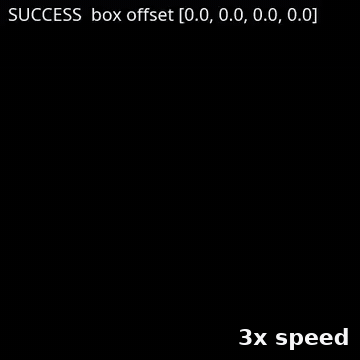</td>
<td width="50%">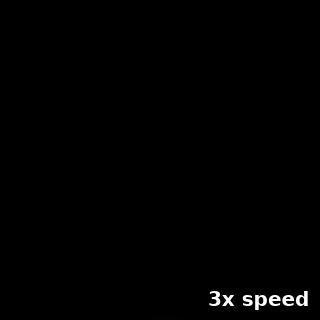</td>
</tr>
<tr>
<td><b>Scripted expert</b>: grasp, handover, place on the tray (3x speed)</td>
<td><b>Learned policy v0, best run</b>: grasps and hands over, then misses the final grasp (3x speed)</td>
</tr>
</table>

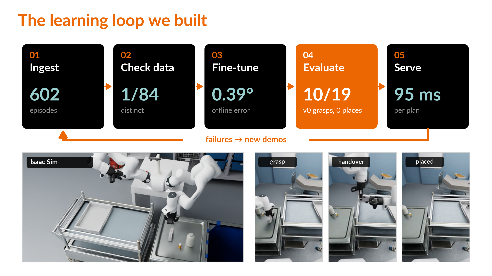

## Why the cathlab

In a cathlab, nurses prepare the patient, monitor them, prepare the equipment and assist the cardiologist during
the procedure, often under acute staff shortage. Much of the equipment work is repetitive: fetching a sterile
package from storage, passing it on, setting it down in the right place. A robot that takes over these motions gives
the nurse time back for the patient.

Two things make this hard:

- **Every new task needs an engineer.** Classic robots are programmed task by task, which doesn't scale to the
  many small handling steps of a procedure. Robots that learn from demonstrations could, but there's no reliable path
  from recorded demonstrations to a tested, versioned robot skill.
- **A hospital needs evidence, not a demo.** Success has to be measured over many runs with confidence intervals,
  failures have to be explained, and the robot has to stay safe when the learned policy goes wrong.

The challenge asked: *how can a human demonstration become a deployed, evaluated and explainable robot model within
72 hours, and get better with each iteration?* The handover task is the first cathlab-style skill we put through
that loop.

### Safety and autonomy for clinical use

- **Designed for task autonomy (level 2).** The nurse starts a task, supervises it and can stop it at any time. No
  patient contact; the robot works outside the sterile field and the patient zone.
- **Supervisor around the learned policy.** It detects missed grasps, stalls, a tipped or dropped object, and
  rewinds and retries or stops (`sim/recovery.py`).
- **Release interlocks.** A gripper only lets go once the other arm holds the object, and the final release only
  happens over the tray.
- **Human sign-off at the boundary (design rule).** Data generation, retraining and evaluation may run
  automatically inside the simulation; any step toward a real robot or the clinic needs a human decision
  ([`docs/methodology.md`](docs/methodology.md)).

## Approach: a five-stage loop

| Stage | What it does | Code |
|---|---|---|
| 01 Ingest | Convert the LeRobot v3 datasets for openpi, trim idle frames, use a fixed train/val split | `pi05/convert_fr3duo_to_openpi.py` |
| 02 Check data | Automatic dataset report: schema, idle time, gripper events, joint-limit margins, motion diversity, outliers, READY / NOT READY verdict | `dataset_check/` |
| 03 Fine-tune | pi0.5 + LoRA via openpi on an RTX 4090, plus an offline accuracy and latency check | `pi05/` |
| 04 Evaluate | Closed loop in Isaac Sim, with milestones per subtask and success rates with 95% Wilson confidence intervals | `sim/policy_rollout.py`, `sim/eval_*.{sh,py}`, `results/` |
| 05 Improve | Failure analysis, then a scripted expert generates new, varied demonstrations for the next model | `expert/`, `sim/expert_demos.py` |

### The engineering behind it

Most of the work was physical and kinematic debugging rather than model training:

- **Kinematics from the scene file.** Forward kinematics, Jacobian and damped-least-squares IK for both FR3 arms,
  built directly from the joint definitions in the USD scene and checked against the recorded data
  (`expert/kinematics.py`, `expert/validate_kinematics.py`). A reachability study maps how far the box can move
  before the arms can no longer reach it.
- **Making the recorded grasp reproducible.** Replaying the recorded joint commands open-loop in Isaac Sim showed
  that the shipped scene couldn't reproduce the grasp: the box had zero mass, and the gripper drive was several
  orders of magnitude stiffer than the one used for recording. Matching the gripper stiffness, damping, force
  limit, box mass and friction to the recording, and finding the correct box start pose, made the full handover
  repeatable (`sim/replay_episode.py`, `sim/fit_box_pose.py`).
- **Safety and recovery layer.** A supervisor around the learned policy detects missed grasps, stalls, a tipped
  box or a dropped box. It rewinds the failing arm and retries. An alignment assist centres the gripper on the box
  before closing, and interlocks make sure a gripper only releases once the other arm holds the box
  (`sim/recovery.py`, `sim/align_assist.py`).
- **Expert demonstration generator.** A scripted expert moves the box by up to ±15 mm and ±5° and adds
  DART-style noise so the data includes corrections. A success check filters each episode. Switching from path
  tracing to real-time rendering cut the time per demonstration from 34 to 6 minutes.
- **Mixed reality.** Prototype that streams the Isaac Sim scene to a Meta Quest 3 over CloudXR, with thumbstick
  locomotion, as a first step toward human teleoperation in VR (`sim/start_vr.py`, `sim/vr_locomotion.py`).

### Deterministic replay and mixed reality

<table>
<tr>
<td width="34%">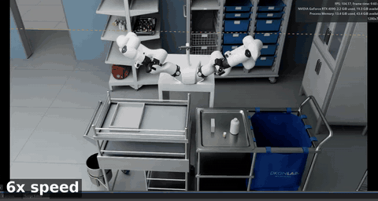</td>
<td width="33%">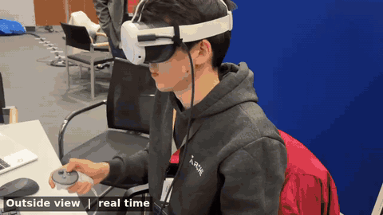</td>
<td width="33%">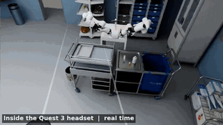</td>
</tr>
<tr>
<td><b>Deterministic replay</b> of a recorded demonstration in Isaac Sim (6x speed)</td>
<td><b>Quest 3</b>: walking the robot scene in VR (real time)</td>
<td><b>Inside the headset</b>: the hospital room and the FR3 Duo (real time)</td>
</tr>
</table>

## Results

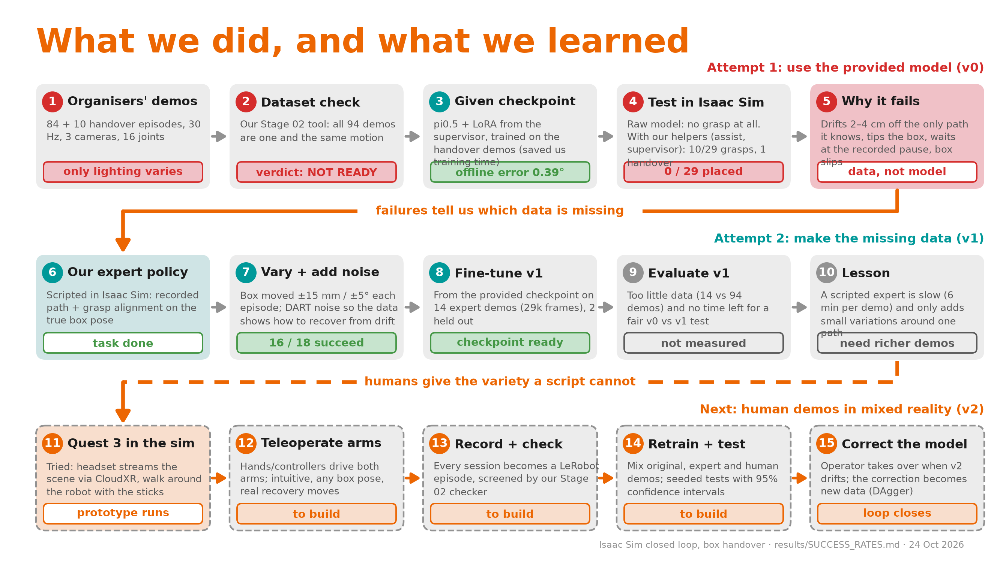

| Finding | Number |
|---|---|
| Provided demonstrations (84 + 10 episodes) | **one motion**: only the lighting varies. Our dataset check returned NOT READY |
| pi0.5 fine-tuned vs zero-shot, offline arm error on held-out episodes | **0.39°** vs 6.79° |
| Inference latency per 10-step action chunk (RTX 4090) | **95 ms** p50, 117 ms p95 |
| v0 policy in closed loop (Isaac Sim) | left grasp 10/29, handover 1/29, **placed 0/29** (95% CI 0 to 12%) |
| Scripted expert with the box moved | **16/18** successful demonstrations (95% CI 67 to 97%) |
| v1 (fine-tuned on 14 expert demonstrations) | checkpoint trained; the closed-loop evaluation didn't finish before the deadline |

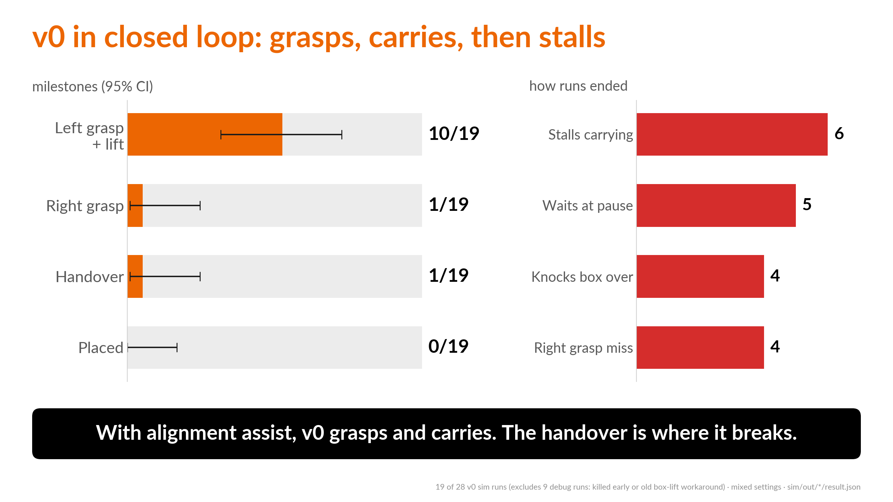

**Why v0 fails.** The policy is accurate offline (0.39°) but drifts 2 to 4 cm off the demonstrated path in the
closed loop. Every training demonstration followed the same path, so the model never saw a correction
(covariate shift). The tall, thin box tips over at that error. The demonstrations also contain a 2.5 s pause with
no visual cue, and the policy waits there indefinitely. The fix is in the data, not the model: varied
demonstrations with corrections.

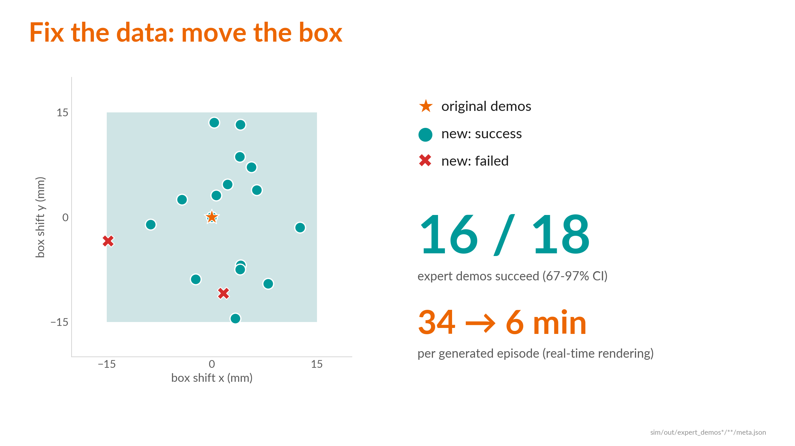

### Videos

All clips come from Isaac Sim and are sped up; the speed is written on each video. Download or open them from
[`media/videos/`](media/videos/).

| Clip | What it shows | Length |
|---|---|---|
| [`expert_success_3cams_3x.mp4`](media/videos/expert_success_3cams_3x.mp4) | Scripted expert completes the task; external, left-wrist and right-wrist cameras | 23 s (3x) |
| [`expert_success_box_moved_pathtraced_3x.mp4`](media/videos/expert_success_box_moved_pathtraced_3x.mp4) | Expert succeeds with the box moved +4.1 mm / -6.9 mm and rotated -4.6°, path-traced render | 23 s (3x) |
| [`v0_best_attempt_3x.mp4`](media/videos/v0_best_attempt_3x.mp4) | Best v0 run: left grasp, right grasp and handover, then the right arm misses before placing | 20 s (3x) |
| [`v0_drift_recorded_vs_sim_3x.mp4`](media/videos/v0_drift_recorded_vs_sim_3x.mp4) | Recorded demonstration (top) vs the policy in the loop (bottom): the arm drifts off the demonstrated path | 26 s (3x) |
| [`v0_supervisor_retry_2x.mp4`](media/videos/v0_supervisor_retry_2x.mp4) | The supervisor detects a missed grasp, rewinds the arm and retries | 13 s (2x) |
| [`deterministic_replay_isaac_sim_6x.mp4`](media/videos/deterministic_replay_isaac_sim_6x.mp4) | Deterministic replay: the recorded joint commands played back open-loop in the live Isaac Sim session, with the matched gripper and box physics; both arms complete the handover | 54 s (6x) |
| [`vr_quest3_isaac_sim.mp4`](media/videos/vr_quest3_isaac_sim.mp4) | Meta Quest 3 in the Isaac Sim hospital room over CloudXR: outside view, then the view inside the headset | 42 s (real time) |

<p>
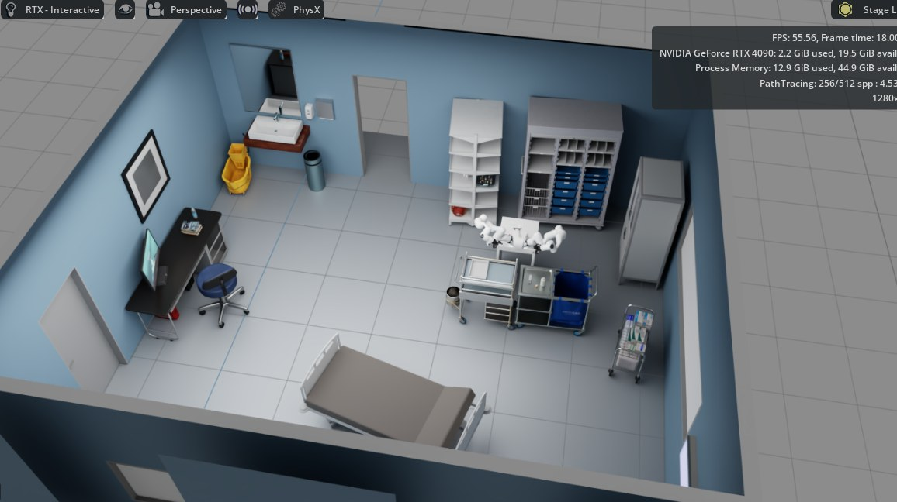
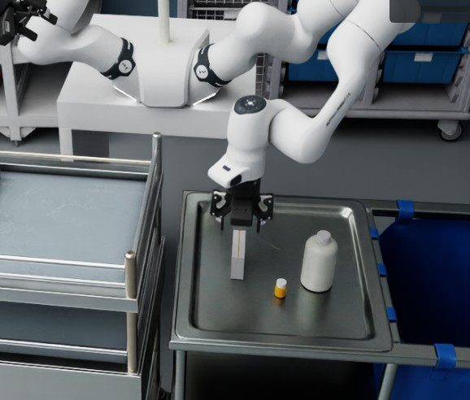
</p>

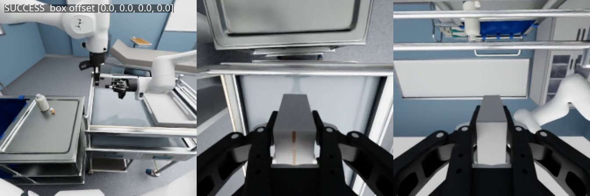

The full run index and success table are in [`results/SUCCESS_RATES.md`](results/SUCCESS_RATES.md). What we would
do next (Genesis-based data generation at about 120 demonstrations per hour, then human demonstrations in VR and
DAgger-style corrections) is in [`docs/genesis_data_engine.md`](docs/genesis_data_engine.md).

## Repository layout

```
dataset_check/   Stage 02: dataset quality checker for LeRobot v3 datasets (runs on a laptop)
expert/          FR3 Duo kinematics, validation against recorded data, reachability study, demo transform
sim/             Isaac Sim: replay, closed-loop rollout, supervisor, alignment assist, expert generator,
                 batch evaluation, Quest 3 / CloudXR prototype
pi05/            openpi integration: data conversion, config patch, training, policy server, offline eval
results/         success rates with confidence intervals and the run index
presentation/    scripts that build the figures and slides
docs/            methodology, pi0.5 training process, data plan, Genesis data engine, figures
media/           demo videos (sped up, speed marked on each clip) and screenshots from Isaac Sim
```

## How to run

The datasets, the Isaac Sim scene and the provided checkpoint belong to Siemens Healthineers and are **not
included**. The code expects them locally.

**Dataset check (any machine, Python 3.10+):**
```bash
cd dataset_check
python3 -m venv .venv && .venv/bin/pip install -r requirements.txt
.venv/bin/python check_dataset.py path/to/dataset.zip      # writes reports/<name>/report.html
```

**Kinematics study (numpy and matplotlib; expects the provided datasets under `C2_Teach-the-robot_VLA/Dataset/`):**
```bash
python expert/validate_kinematics.py
python expert/run_expert_study.py --n 50 --seed 0
```

**Simulation and training** (tested on Ubuntu 24.04, RTX 4090 24 GB, Isaac Sim 6.0.1 pip install, openpi with JAX):
```bash
export ISAAC_PY=~/isaac-env-6/bin/python ISAAC_PYDEPS=~/.isaac-pydeps REPO_DIR=$PWD
pi05/setup_openpi.sh                                        # clone openpi, apply our config patch
$ISAAC_PY sim/replay_episode.py --episode 0 --headless      # open-loop replay of a recorded episode
PYTHONPATH=$ISAAC_PYDEPS $ISAAC_PY sim/policy_rollout.py --headless   # closed loop (policy server on :8000)
sim/gen_demos.sh 3 8 sim/out/expert_demos                   # generate expert demonstrations
python3 results/collect_results.py                          # rebuild the success table
```
Each folder has its own README or docstrings with the full options.

## Not included

The Genesis-based data generator and the HG-DAgger work described in `docs/genesis_data_engine.md` are not part
of this repository.

## Acknowledgements

Thanks to Siemens Healthineers for hosting the hackathon and providing the scene, the datasets and the
mentoring. Built on [openpi](https://github.com/Physical-Intelligence/openpi),
[LeRobot](https://github.com/huggingface/lerobot) and [NVIDIA Isaac Sim](https://developer.nvidia.com/isaac/sim).

## License

Code: Apache-2.0 (see [LICENSE](LICENSE) and [NOTICE](NOTICE)). The organiser-provided data, scene and
checkpoint are not part of this repository. The screenshots and videos in `media/` and some figures are rendered
from the organiser-provided scene; they are shown for illustration and are not covered by the Apache license.
