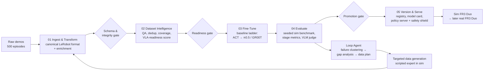

# Methodology and autonomy levels (plan written on day 1)

*Siemens Healthineers Robotics & AI Hackathon 2026, Challenge 2, Erlangen, 22 to 24 Oct 2026.*

This is the design we wrote at the start of the hackathon. It describes the full target pipeline. Not every
part was built in the 58 hours: see the main [README](../README.md) for what was actually implemented and
measured (for example, the MLflow registry, the VLM judge and the LLM loop agent stayed at concept level).

---

## 1. Methodology: the "Demonstrate → Deploy" learning loop

### 1.1 Design principles
1. **Walking skeleton first.** By the end of Day 1 a thin, ugly but complete path runs through all five stages. After that we deepen each stage. This guarantees the Definition of Done.
2. **Data-centric.** Most of the gain comes from better data (curation, enrichment, targeted generation), not from model tricks.
3. **Quality gates between stages.** Each stage emits a machine-readable report and a pass/fail decision. Gates are what make autonomy safe.
4. **Everything versioned and content-hashed.** One command reproduces any model and its evaluation.
5. **Closed-loop evaluation in sim is the ground truth.** Offline loss is a debugging signal only.
6. **One policy interface for sim and real.** Swapping the environment must not change the model or the server.

### 1.2 Architecture

### 1.3 Stage by stage

#### 01 — Ingest & Transform
- **Canonical format: LeRobot dataset** (parquet for state and action, MP4 for video, plus meta JSON). Both openpi and GR00T fine-tuning consume this format, so we don't lock into one model.
- **Loss-free conversion.** Keep timestamps and synchronize all cameras with joint states. Define the action space explicitly: absolute vs. delta joints or end-effector pose, gripper encoding, and both arms of the Duo. Keep episode boundaries and the task string.
- **Replay test (critical):** play the recorded actions back open-loop in the simulator and check that the task still succeeds. This proves the action space, frame conventions and control frequency are correct before any GPU time is spent.
- **Enrichment:**
  - *Subtask segmentation* (reach → grasp → lift → transport → place → release), from gripper state and velocity profiles plus simulator contact state.
  - *Language annotations*: task and subtask instructions, with paraphrases for VLA language robustness.
  - *Privileged labels* from the simulator: object poses, success predicates, contacts.
  - *Normalization statistics* (quantile-based).
- **Gate output:** `ingest_report.json` (schema validity, % of episodes converted, replay success rate) and a content-hash manifest.

#### 02 — Dataset Intelligence
An automated **Dataset Readiness Report** that a human can read in 2 minutes:
- **Validity:** NaNs, joint-limit or velocity violations, timestamp gaps, dropped frames, action discontinuities (jerk spikes), long idle segments, truncated or failed episodes (via sim success predicates).
- **Redundancy:** near-duplicate episodes, using image embeddings (DINOv2/SigLIP) plus DTW distance on trajectories.
- **Representativeness and coverage:** heatmaps of initial object positions over the workspace, distribution of object types, scene and lighting, and multimodality (different strategies across operators). UMAP clusters of episode embeddings.
- **Gaps:** under-covered regions of the task space, such as object poses at the shelf edge, a missing object variant, or no recovery behaviour. These feed directly into the data plan.
- **VLA-readiness checklist:** language present, camera views (wrist + scene), resolution, control frequency vs. action-chunk horizon, normalization, train/val split by episode *and* by held-out configurations.
- **Per-episode quality score** → `curated_v1` dataset.
- **Proof of value:** ablation of training on the full set vs. the curated set (reported in stage 04).

#### 03 — Fine-Tune
**Baseline ladder.** Every rung is a working fallback.

| Rung | Model | Why |
|---|---|---|
| 0 | **Scripted expert policy** (uses privileged sim state: object pose → motion plan) | Upper bound, sanity check, *our "own expert policy"* for the demo, and a **synthetic data generator** for the loop |
| 1 | **ACT or Diffusion Policy** (LeRobot) | Trains in a few GPU-hours, low latency, strong single-task baseline |
| 2 | **VLA: π0.5 via openpi (primary)** or **GR00T N1.x** (if the env is Isaac-native and GPU memory allows) | Language-conditioned, generalizes across objects and scenes, reusable across tasks: the "Physical AI" target |

- **Strategy:** LoRA or partial fine-tuning first (fits on one GPU, fast iterations). Full fine-tuning only if compute allows. Action chunking with an asynchronous inference client to meet control-rate latency.
- **Model choice is a 1-hour decision on Day 1**, recorded as a short decision record. Criteria: available GPUs/VRAM, simulator (Isaac → GR00T is natural; otherwise openpi), dataset embodiment (bimanual), and latency budget.
- **Tracking:** Hydra configs, MLflow or W&B runs, a checkpoint every N steps, and early closed-loop evaluation of intermediate checkpoints.

#### 04 — Evaluate
A **reproducible simulation benchmark**: `eval --model <id> --suite <name>` always gives the same numbers.
- **Suites:** *nominal* (training distribution), *perturbed* (object pose, lighting, camera jitter, distractors) and *OOD* (unseen object variant or placement), each with fixed seed lists.
- **Metrics:**
  - Success rate **with 95% Wilson confidence intervals**, so success is no longer just binary.
  - **Progress score / failure stage**, from sim predicates per subtask (reached? grasped? lifted? placed?). This answers *where* execution degrades.
  - Time to completion, path smoothness (jerk), collisions and contact-force or safety violations.
  - **Inference latency p50/p95** and achieved control frequency.
- **Option A, Intelligent Success Judgement:** a VLM reviews the rollout video and produces a natural-language explanation ("grasp slipped during transport at t=4.2 s"). It is **calibrated against sim ground-truth predicates**, and we report agreement, which makes the judge trustworthy enough to reuse on real-robot footage where no predicates exist.
- **Output:** an evaluation report card (HTML/JSON) attached to the model version, plus a failure gallery of video clips.

#### 05 — Version & Serve
- **Model registry (MLflow):** each version stores dataset hash, config, git commit, checkpoint, eval report and an auto-generated **model card** (intended use, limits, known failure modes).
- **Promotion stages:** `candidate → sim-validated → (future) real-validated`, controlled by gate rules (e.g., no regression beyond the CI on any suite and p95 latency under budget).
- **Serving:** a containerized **policy server** (websocket/gRPC, like the openpi server) with a stable API: `observation + instruction → action chunk`. A thin client connects it to the sim, and later to the real FR3 Duo through ROS 2. Same API both ways.
- **Safety shield** between policy and robot: joint, velocity and workspace limits, a keep-out zone (patient/sterile field), action-magnitude clipping, a confidence / OOD watchdog that triggers *hold + ask a human*, and an e-stop.

### 1.4 Closing the loop (Option B, Self-Improving Pipeline)
1. Evaluation produces failure stages and clusters (e.g., "grasp failures with objects at the left shelf edge").
2. The **Loop Agent** (an LLM agent with tool access to the reports) links the failures to the dataset coverage gaps from stage 02 and writes a **data plan**: *"generate 60 demos with objects in region X; add recovery demos for regrasp."*
3. The scripted expert produces those demos in simulation, with domain randomization.
4. Those demos re-enter stage 01 → retrain → re-evaluate → promote if better.
5. **Hackathon target: show at least two iterations (v0 → v1 → v2) with measured improvement and an explanation of each step.** This answers "improve with each iteration" directly.

### 1.5 Optional modules: recommendation
- **A (Success Judgement) + B (Self-Improving): build both.** They reinforce each other and target the two stated pain points (non-reproducible evaluation, no iteration).
- **D (Skill Orchestration): concept plus light prototype if time allows.** An LLM splits "prepare the catheter set" into subtasks → picks a policy per subtask → wraps them in safety and latency guardrails. This is the bridge to the clinical story.
- **C (Learning Network): concept slide only.** Federated registry of validated skills across sites and embodiments.

---

## 2. Autonomy level

We specify autonomy along **two axes**, because the challenge combines a learning system and a robot.

### 2.1 Robot task autonomy (clinical axis)
Using the medical-robotics autonomy scale (Yang et al., *Science Robotics* 2017, levels 0–5):

**Target: Level 2, Task Autonomy.**
The robot carries out a discrete manipulation task autonomously (e.g., "take the guidewire package from storage and place it on the side table") **after an operator initiates it**. The nurse picks the task, supervises, and can pause or stop at any time. There is **no patient contact** and the robot stays outside the sterile field and the patient zone, which is enforced by the safety shield.

*Roadmap:* With Option D, the system moves toward **Level 3, Conditional Autonomy**: it proposes a task sequence (e.g., a full kit for the scheduled procedure) and a human approves it. Levels 4–5 are explicitly out of scope for a clinical environment.

### 2.2 Learning-pipeline autonomy (MLOps axis)
| Level | Description |
|---|---|
| L0 | Manual scripts, manual evaluation (the current state described by SHS) |
| L1 | Tool-assisted: individual stages automated |
| L2 | Automated pipeline: one command runs 01→05; a human triggers each run and reads the results |
| **L3** | **Supervised autonomy: the loop runs end to end, the agent diagnoses failures and proposes the next data or training step; a human approves at quality gates** |
| L4 | Fully autonomous within the simulation sandbox: generate → train → evaluate → register without a human |
| L5 | Autonomous deployment to real robots |

**Target: L4 inside the simulation sandbox, L3 at the boundary.** Data generation, retraining, evaluation and promotion to `sim-validated` run without a human. **Any step toward the real robot or the clinic** (promotion to `real-validated`, deployment) **always needs human sign-off.** This is the "human-in-the-loop at the right place" position that fits a regulated medical-technology company.
